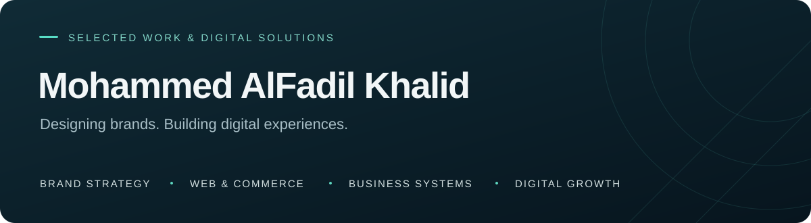

# ملف الأعمال

### محمد الفاضل خالد

أعمال في تطوير المواقع والمنتجات الرقمية، التجارة الإلكترونية، تصميم الهوية والتسويق. يعرض هذا الملف نطاق مساهمتي في المشاريع، مع جمع مراحل العمل المختلفة تحت اسم المشروع نفسه.

**[العودة للبروفايل](https://github.com/Aljrah1) · [سوداسبارك](https://www.sudaspark.com) · [للتواصل المهني](mailto:support@sudaspark.com)**

---

## المواقع والتجارة الإلكترونية

### مصنع بروق للعطور

**التجارة الإلكترونية وخدمات التصنيع للشركات**

تجربة رقمية تجمع بيع العطور للأفراد واستقبال طلبات تصنيع العلامات الخاصة للشركات ورواد الأعمال.

**نطاق عملي:** تطوير المتجر وتحسين عرض المنتجات ورحلة الشراء، بناء مسارات طلبات التصنيع وعروض الأسعار والمتابعة، وربط أدوات التسويق وخدمة العملاء. يشمل العمل أيضاً تطوير تجربة مستقلة لطلبات الشراء والتصنيع للشركات.

[زيارة بروق](https://broaq.com)

### جمعية عنيزة لحفظ النعم «نِعَم»

**منصة للخدمات المجتمعية وتجربة التبرع**

حضور رقمي يجمع مبادرات الجمعية وفرص التبرع والخدمات الإلكترونية ومحتوى الحوكمة والأخبار.

**نطاق عملي:** تطوير الموقع وبوابات الخدمات، تحسين رحلة المتبرع والمستفيد، إعداد صفحات الحملات، وأدوات إدارة المحتوى والتسويق وقياس الأداء.

[زيارة نِعَم](https://neam.sa)

### سوداسبارك

**حضور رقمي وإدارة خدمات التسويق والتقنية**

موقع يعرض الخدمات والأعمال ويربطها بمسارات استقبال العملاء ومتابعة طلباتهم.

**نطاق عملي:** تصميم وتطوير تجربة الموقع والخدمات، وتنظيم العملاء والمحتوى وعروض الأسعار. يمتد العمل إلى تطوير أدوات لإدارة الخطط التسويقية والمهام والموافقات، ومساحة لإدارة المحتوى والحسابات الاجتماعية.

[زيارة سوداسبارك](https://www.sudaspark.com)

### جنصصة

**متجر للأزياء والملابس الشبابية**

تطوير تجربة عرض المجموعات والمنتجات والطلب، مع مساحات لتخصيص المنتجات ومتابعة الطلبات وخدمة العملاء.

### كوني جميلة

**متجر لمنتجات الجمال والعناية**

تطوير واجهة تسوق منظمة تشمل تصفح المنتجات والسلة والطلب وحساب العميل، مع أدوات لإدارة محتوى المتجر وطلباته.

### تحفة التميز

**موقع شركة للألمنيوم والزجاج والكلادينج**

تصميم وتطوير تجربة تعرض الخدمات والمشاريع والتقنيات وتدعم طلب عروض الأسعار. يشمل نطاق العمل إدارة المحتوى وتنظيم قنوات التواصل مع العملاء.

---

## أنظمة إدارة الأعمال والتسويق

### Kinexar

**إدارة الوكالات والمشاريع والعملاء**

منصة لتنظيم العلاقة مع العميل ودورة تنفيذ المشروع في مساحة واحدة.

**نطاق عملي:** تجربة إدارة العملاء والمشاريع، عروض الأسعار والفواتير، بوابة العملاء ومراجعة الأعمال والموافقات، ومسارات أتمتة الإجراءات والتواصل.

### BROAQ Ads OS

**إدارة الحملات والأتمتة التسويقية — قيد التطوير**

تطوير منصة تجمع متابعة الأداء الإعلاني وإدارة الحملات وقواعد الأتمتة ومسارات ربط المتاجر بأدوات التسويق. يركز العمل على وضوح المؤشرات وتنظيم الإجراءات والمتابعة من مساحة موحدة.

### سودابرو

**منصة الخدمات والعمل الحر — تطوير مستمر**

تطوير تجربة تجمع المستقلين وطالبي الخدمات، وتشمل عرض الخدمات والملفات المهنية، تنظيم الطلبات والمشاريع، والتواصل بين أطراف العمل.

---

## المطاعم وتجربة الضيف

### Smart Menu AI

**المنيو الرقمي وإدارة الطلبات**

تطوير منصة تساعد المطاعم على تنظيم المنتجات والأقسام وعرض المنيو على الهاتف عبر رابط أو رمز QR، مع لوحات لإدارة الطلبات وأدوات مساعدة لإعداد المحتوى.

### مطعم الشرفة

**الموقع التعريفي واستقبال طلبات التوظيف**

مساران للعمل: إعادة تصميم الموقع لعرض تجربة المطعم والمأكولات والتواصل، وتطوير نموذج توظيف بالعربية والإنجليزية ينظم بيانات المتقدم والخبرة والسيرة الذاتية. نموذج التوظيف له نسخة منشورة، وتصميم الموقع قيد التطوير.

### سيريه الريف

**تقييم تجربة الضيف**

تصميم وتطوير تجربة لجمع التقييمات والاقتراحات بالعربية والإنجليزية، مع تحديد الفرع والطاولة وإتاحة الوصول عبر QR.

### الريف — المكافآت والقسائم

**إدارة العروض وحملات المكافآت**

تطوير مسارات لإصدار القسائم وتنظيم الحملات والشركاء والتحقق من الاستخدام، مع أدوات للمتابعة والتقارير.

---

## التعليم والمبادرات المجتمعية

### رِواق 6

**المنصة الأكاديمية لدفعة ماجستير تقانة المعلومات بجامعة الإمام الهادي**

تطوير تجربة تجمع المقررات والمحاضرات والواجبات والاختبارات، مع بوابات تناسب أدوار الطالب وعضو هيئة التدريس والإدارة.

يشمل مسار العمل نماذج لمركز الاختبارات الإلكترونية ولوحات المتابعة والجداول ومسارات المراقبة والمراجعة الأكاديمية.

### أكاديمية خطي التعليمية

**عرض البرامج والدورات والتسجيل**

تطوير واجهة أكاديمية للتعريف بالبرامج وعرض الدورات ومسارات التسجيل، مع تجربة بالعربية والإنجليزية.

### منصة مجتمع الخريجين

**التواصل المهني والورش والشهادات**

تطوير تجربة تجمع ملفات الخريجين والفعاليات والورش، وتنظم التسجيل والحضور وإعداد الشهادات وإصدارها.

### مبادرة تأهيل مدرسة الهدى الثانوية بنين

**عرض تفاعلي لمتابعة أعمال الصيانة — مساهمة في مشروع مشترك**

المساهمة في إعداد عرض رقمي يجمع تقدم أعمال الصيانة والترميم والاحتياجات، ويسهّل متابعة المجتمع للمبادرة.

---

## منتجات أواصل تطويرها

### سودارايد

**خدمات التوصيل**

تطوير تجربة تربط العميل والكابتن ومركز العمليات؛ تشمل إنشاء الطلب وحساب السعر ومتابعة مراحل التوصيل والدعم. يركز العمل على سهولة الاستخدام على الهاتف ووضوح مسؤوليات كل طرف.

### سودادار

**منصة عقارية للسوق السوداني**

تطوير تجربة للبحث عن العقارات وعرضها للبيع والإيجار، مع فلاتر ومفضلة وملفات للمعلنين ومسار لإضافة الإعلان ومراجعته.

### SudaStore

**متاجر إلكترونية للتجار في السودان — مساهمة في مشروع مشترك**

المساهمة في تجربة إدارة المنتجات والطلبات وواجهات المتاجر، مع مسارات للتواصل عبر واتساب وتوثيق الدفع المحلي ومتابعة الطلب.

### MassUp Pro

**تنظيم التدريب ومتابعة التقدم**

تطوير تجربة مناسبة للهاتف لتنظيم خطط التمرين وتسجيل الأداء ومتابعة التقدم والعادات الغذائية.

### منصة التحكيم الإلكتروني

**نموذج لتجربة إدارة القضايا والجلسات**

تصميم نموذج واجهة عربية لاستكشاف استقبال القضايا وإسنادها وتنظيم الجلسات والمتابعة. يُعرض ضمن أعمال تصميم التجارب والنماذج الأولية.

---

## الهوية البصرية والمحتوى والخدمات الإبداعية

### أبراج الكيف

تصميم المواد البصرية وكتابة المحتوى الدعائي لدعم حضور المتجر والتواصل مع العملاء.

[زيارة الموقع](https://abragalkaif.com)

### جوافة

تصميم البنرات الإعلانية وتنظيم وإدخال بيانات المنتجات بما يدعم عرضها داخل المتجر.

[زيارة الموقع](https://jawavah.com/ar)

### الأمل العقارية

تصميم الهوية البصرية وتطوير الموقع الإلكتروني، لربط صورة العلامة بتجربة عرض خدماتها.

[زيارة الموقع](https://amal-land.com)

### نقطة حبر

**خدمات الطباعة — مساهمة في مشروع مشترك**

المساهمة في تطوير تجربة رقمية لعرض المنتجات الطباعية وخياراتها، واستقبال الطلبات وإدارة المحتوى.

### أعمال الهوية والمحتوى

تصميم شعارات وهويات بصرية وبنرات ومحتوى لوسائل التواصل، إلى جانب تصميم وتطوير ملفي المهني لعرض الخدمات والخبرات والأعمال.

---

## الخدمات

**تصميم الهوية والتواصل البصري** — الشعارات، الهوية البصرية، المواد الدعائية ومحتوى وسائل التواصل.

**تطوير المواقع والمتاجر** — مواقع الشركات، صفحات الهبوط، المتاجر الإلكترونية وتجارب الشراء وطلبات الأعمال.

**تطوير أنظمة الأعمال** — إدارة العملاء والمشاريع والطلبات، لوحات المتابعة ومسارات الموافقة.

**الأتمتة والذكاء الاصطناعي** — ربط الأدوات، تنظيم الإجراءات المتكررة، وحلول مساعدة للمحتوى وفرق العمل.

**التسويق والتحليل** — تخطيط المحتوى والحملات، التتبع والتحليلات وتحسين الظهور في البحث.

### هل لديك مشروع يناسب هذه الخبرات؟

**[تواصل عبر سوداسبارك](https://www.sudaspark.com) · [support@sudaspark.com](mailto:support@sudaspark.com)**

