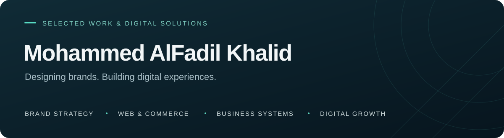
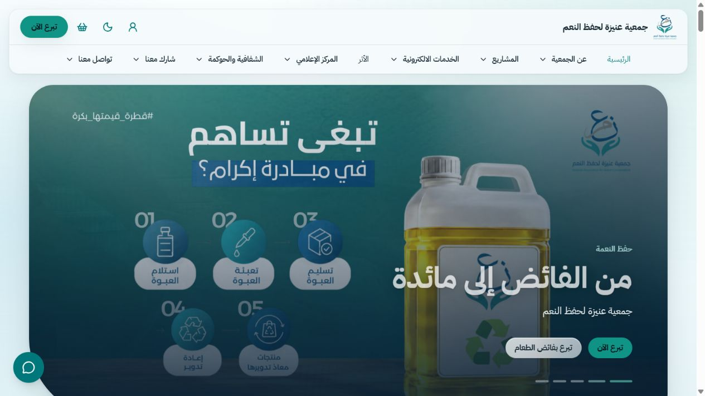
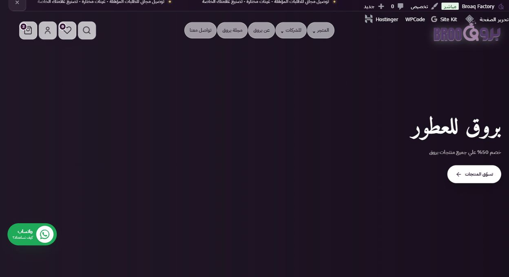

# محمد الفاضل خالد

### تطوير المنتجات الرقمية · تصميم الهوية · التسويق الرقمي

أساعد المشاريع على بناء حضور رقمي متكامل، من الهوية البصرية وتجربة الموقع إلى المتجر الإلكتروني وأدوات إدارة العمل. أجمع بين التصميم والتطوير والتسويق لصناعة تجربة واضحة للعميل وأدوات عملية للفريق.

**[سوداسبارك](https://www.sudaspark.com) · [ملف الأعمال](https://github.com/Aljrah1/Aljrah1/blob/main/PROJECTS.md) · [تواصل للعمل](mailto:support@sudaspark.com)**

---

## من أعمالي

<table dir="rtl">
<tr>
<td width="50%" valign="top" align="right">

<h3>جمعية نِعَم</h3>

القطاع غير الربحي · تجربة التبرع والخدمات

تطوير الحضور الرقمي لجمعية عنيزة لحفظ النعم، وربط المبادرات والتبرعات والخدمات الإلكترونية بتجربة موحدة للمتبرع والمستفيد.

<b>نطاق عملي:</b> تطوير الموقع، تحسين رحلة التبرع، صفحات الحملات، وأدوات إدارة المحتوى والتسويق وقياس الأداء.

<a href="https://neam.sa">زيارة الموقع ↗</a>

</td>
<td width="50%" valign="top" align="right">

<h3>مصنع بروق للعطور</h3>

التجارة الإلكترونية · خدمات التصنيع للشركات

تجربة رقمية تجمع متجر العطور وخدمات تصنيع العلامات الخاصة، وتربط رحلة الشراء بطلبات الأعمال وخدمة العملاء.

<b>نطاق عملي:</b> تطوير المتجر، تحسين تجربة الشراء، بوابة طلبات الشركات، تكامل الأدوات والتتبع التسويقي.

<a href="https://broaq.com">زيارة الموقع ↗</a>

</td>
</tr>
<tr>
<td width="50%" valign="top" align="right">
<h3>سوداسبارك</h3>

الخدمات الرقمية · إدارة الأعمال والتسويق

منظومة تجمع عرض الخدمات والأعمال مع تنظيم العملاء والمحتوى والطلبات وخطط التسويق.

<b>نطاق عملي:</b> تصميم وتطوير الموقع، تجربة تقديم الخدمات، وأدوات متابعة التنفيذ والتواصل مع العملاء.

<a href="https://www.sudaspark.com">زيارة الموقع ↗</a>

</td>
<td width="50%" valign="top" align="right">
<h3>Kinexar</h3>

إدارة الوكالات والمشاريع

منصة تجمع دورة العمل من استقبال العميل إلى إدارة المشروع وعروض الأسعار والفواتير ومراجعة الأعمال.

<b>نطاق عملي:</b> تطوير تجربة الإدارة، بوابة العملاء، مسارات الموافقة وأتمتة الإجراءات.

</td>
</tr>
<tr>
<td width="50%" valign="top" align="right">
<h3>رِواق 6</h3>

التعليم الإلكتروني · الإدارة الأكاديمية

منصة أكاديمية لدفعة ماجستير تقانة المعلومات بجامعة الإمام الهادي، تجمع المقررات والمحاضرات والواجبات والاختبارات.

<b>نطاق عملي:</b> تجربة التعلم، تنظيم المحتوى، وبوابات الطالب وعضو هيئة التدريس والإدارة.

</td>
<td width="50%" valign="top" align="right">
<h3>Smart Menu AI</h3>

تقنية المطاعم · المنيو والطلبات

منصة للمنيو الرقمي وإدارة المنتجات والطلبات، مع وصول عبر رموز QR وأدوات مساعدة لإعداد المحتوى.

<b>نطاق عملي:</b> تجربة المنيو على الهاتف، لوحات الإدارة، تنظيم الطلبات ومسارات المساعدة بالذكاء الاصطناعي.

</td>
</tr>
</table>

## مشاريع أواصل تطويرها

**BROAQ Ads OS — إدارة الحملات والأتمتة**  
تطوير مساحة تجمع متابعة الأداء الإعلاني، إدارة الحملات، تكامل المتاجر وأتمتة المهام التسويقية.

**سودارايد — خدمات التوصيل**  
تطوير تجربة تربط العميل بالكابتن ومركز العمليات، من إنشاء الطلب إلى متابعة مراحل التوصيل والدعم.

**سودادار — المنصة العقارية**  
تطوير تجربة البحث عن العقارات وعرضها للبيع والإيجار، مع تنظيم الإعلانات والمفضلة وحسابات المعلنين.

**سودابرو — الخدمات والعمل الحر**  
تطوير منصة تجمع المستقلين وطالبي الخدمات، وتنظم عرض الخدمات والتواصل وإدارة الطلبات.

**[استعرض بقية المشاريع ونطاق العمل في كل منها ←](https://github.com/Aljrah1/Aljrah1/blob/main/PROJECTS.md)**

---

## كيف أساعد مشروعك؟

**الهوية والتصميم**  
شعارات وهويات بصرية ومحتوى إعلاني يمنح علامتك حضوراً متناسقاً عبر الموقع والمتجر وقنوات التواصل.

**المواقع والمتاجر**  
مواقع شركات وصفحات هبوط ومتاجر إلكترونية، مع تنظيم المحتوى والمنتجات وتبسيط رحلة العميل.

**أنظمة العمل والأتمتة**  
أدوات لإدارة العملاء والمشاريع والطلبات والموافقات، وربط الخدمات لتقليل العمل المتكرر وتسهيل المتابعة.

**التسويق وقياس الأداء**  
خطط محتوى وحملات، إعداد أدوات التحليل والتتبع، وتحسين الظهور في البحث لدعم قرارات التسويق.

## أعمال في التصميم والتجارة

**أبراج الكيف** · المواد البصرية والمحتوى الدعائي.  
**جوافة** · البنرات الإعلانية وتنظيم بيانات المنتجات.  
**الأمل العقارية** · الهوية البصرية وتطوير الموقع.  
**نقطة حبر** · مساهمة في تجربة عرض المنتجات الطباعية وطلب الخدمات.

---

### لنحوّل فكرة مشروعك إلى تجربة واضحة.

يسعدني مناقشة احتياجك وتحديد نطاق مناسب للتصميم أو التطوير أو التسويق.

**[تواصل عبر سوداسبارك](https://www.sudaspark.com) · [البريد المهني](mailto:support@sudaspark.com)**

English overview

I'm **Mohammed AlFadil Khalid**, working across digital product development, brand design, e-commerce and marketing through **SudaSpark**. My work spans commercial websites, business platforms, education, community services and products under continued development. This portfolio presents project experience and contributions.

[Business enquiries](mailto:support@sudaspark.com) · [Portfolio](https://github.com/Aljrah1/Aljrah1/blob/main/PROJECTS.md)

